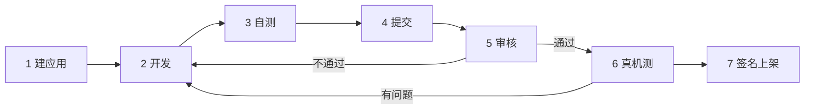

# 从想法到上架

一个应用从想法到用圆屏的人能装上，走下面七步。你做前四步，我们（Tikpal）做后三步；双方只在开发者平台 developer.tikpal.ai 上交接：应用在那里建，提交包在那里传，审核进度和意见也写在那里。开发包仓库不收「立项」单、「提交」单，只收要改开发包本身的「需求」单。每一步的条件、命令和交什么，[AGENTS.md](../AGENTS.md) 里写得更全；两份对不上时以它为准。

开发包仓库是公开的，里面的「需求」单谁都看得见：**不要贴账号、手机号、邮箱、设备编号、令牌**；日志用 `./kit logs`、`./kit info` 出来的（已经抹掉了设备编号）。



## 1. 建应用（在开发者平台）

先成为开发者：在 developer.tikpal.ai 用 Tikpal 账号登录，填资料和邀请码，签开发者协议（现在只收邀请的开发者）。然后在「我的应用」点「建应用」，填这几样：

- **slug**：应用的名字，小写字母、数字和连字符，字母开头，2–24 个字符，比如 `my-timer`。建了不能改，商城和 Tikpal Voice 都靠它认应用。被用了或者是保留的，网站当场会说。
- **中文名、英文名**，**一句话说它能做什么**。
- **要哪些云能力**（AI 对话、语音识别、语音合成……）、**要用哪些硬件**（喇叭、麦克风、动作感应、TF 卡、蓝牙）、给谁用、有没有手机小程序。

点「建好，发编号」，当场拿到**应用编号**，写进 `app.json` 的 `voiceCode`（[app.json 规范](app-json.md)）。

能力在这个应用的「能力和权限」页看批没批：花用户点数的云能力（AI 对话、语音识别、语音合成、录音转文字……）、麦克风、面向儿童这几类要人工批，我们通常 1 个工作日内回；批之前不影响你写不用这些能力的部分。以后要加能力，也在这一页申请。

「商店素材」页填图标、截图、四种语言的名字和介绍、分类、年龄分级、收不收集用户数据。可以边开发边填，提交前要齐。

用户会说的话写进 `app.json` 的 `launch.examples`：点了名的（「打开计时器」），和没点名、只说想做什么的（「帮我计时十分钟」）。伙伴找应用主要靠后一类。

## 2. 开发

- `./kit new <slug>` 起仓库（[上手](getting-started.md)）。一个应用一个仓库，放在你自己的 GitHub 上。仓库可以公开；私有的话，把 `vzheng56` 加成协作者。
- 照[应用开发指南](app-guide.md)和[圆屏设计规范](round-screen-design.md)写；应用清单照 [app.json 规范](app-json.md)。
- 开发包（`devkit/`）只读。组件缺什么能力，在开发包仓库开「需求」单，我们做进下一版开发包；不要在你的仓库里改组件或者复制一份改。
- 换开发包版本：`./kit update <版本>`，编译、自测过再提交。
- **版本号只往上走。** 圆屏查更新时不看账号有没有这个应用，只看位置上装的 slug 和版本号：商城里只要有同一个 slug、版本更新的发布，就把你用 USB 写进去的那份当成旧版，用户一点更新就换成商城上的版本。所以建应用时 slug 就不许重名；上架以后接着开发，USB 写的版本号也不能比商城上的低。

## 3. 自测

照[兼容检查清单](checklist.md)走一遍，每项都要留证据：

- 截图（`./kit snap`）对照设计规范；放在应用目录的 `shots/` 里（最多 8 张），提交时会打进包；
- 内存日志（`./kit info` 的 `heap.internalMinSinceReady`）：内部 RAM 最低不低于 **40,000 字节**；用到最重的那一刻以后 `./kit info > heap.json` 存一份；
- 双击侧键开应用环，点中间回到 Tikpal 主固件；从应用环换到别的应用再回来；
- 没网、低电量下的样子；中文和英文两套界面文字都放得下（日文、西班牙文账号现在显示英文）。

再用 skill `tikpal-review` 照[审核规则](review-rules.md)自审一遍，写出 `ai-selfreview.json`。`shots/`、`heap.json`、`ai-selfreview.json` 不用提交进 git，要在应用仓库的 `.gitignore` 里：`./kit check` 把没进 git 的文件也当成没提交的改动。`./kit new` 建的已经写了，开发包 1.9 以前建的应用自己加上。

## 4. 提交

先 `./kit build --release`，再跑 `./kit check`，要全过（最后一行是「✓ 都过了」）。所有改动提交、推到 GitHub，然后：

```bash
./kit submit --heap heap.json
```

它打出一个 `<slug>-<版本>.tikpal`：源码、`app.json`、镜像、小程序包和自测报告（`./kit check` 的输出、内存、`ai-selfreview.json`、截图）。只打包，不上传。只改了小程序就用 `./kit submit --miniapp-only`。

到 developer.tikpal.ai 这个应用的「版本」页，把它拖进去。网站当场拆包、核清单，列出「包里有什么」，有问题当场说；没问题就填「这一版做了什么（会给用户看）」，点「提交审核」。「商店素材」不齐交不了；审核看的、上架用的，都是提交那一刻的素材。

镜像的 SHA-256：推上去以后，应用仓库 CI（GitHub Actions 的 Check）里的 `./kit check` 会打出一串，用 `./kit submit --ci-sha <那一串>` 带上，重编就要跟它一字不差。不带也行：Mac 上编的和 Linux（GitHub 的机器、我们审核重编的地方）编的永远差 60 几个字节：乐鑫两个平台的工具链在调试信息里带的路径不一样，ELF 哈希和它带出来的两处校验跟着变，代码和数据一字不差。不带 `--ci-sha` 时，我们就拿你包里 Mac 上编的镜像比，只许差这几处。Mac 上编的照样拿去自测。

开发者平台是双方唯一的交接点。审核意见写在「版本」页这一版的进度里；被退回了照着改，再 `./kit submit`、上传（被退回的版本号可以原样再交，发出去过的版本号不能再用）。

## 5. 审核（我们）

1. **按提交号重编**：在 GitHub 的机器上、跟你应用仓库 CI 一样的容器里，用你写的那个开发包版本，把那个提交重编一遍。编出来的字节要和你 `--ci-sha` 给的一样；没给就跟你包里的镜像比，只许差 ELF 哈希和两处校验（`devkit/tools/compare_images.py` 就是这么比的）。对不上就退回：多半是有没提交的改动，或者用了别的开发包版本。
   - 重编跑在开发包这个**公开仓库**的 Actions 里：那次运行的名字和输入里有**你的应用仓库地址和提交号**，登录 GitHub 的人都看得到。源码清单、镜像、ELF、编译和检查的输出都封给我们的审核机，别人打不开；公开的日志里只有每一步过没过和几个错误、几个警告。
2. **机器审**：包里的源码跟提交一样；镜像不超过 3.5 MB；`app.json` 合规；主机测试通过；提交用的那份不带开发命令；只调开发包允许的系统函数；小程序只用声明过的能力、没有外部网址；文字和图片过内容审核。`app.json` 里要的能力，和「能力和权限」批的对一遍，多要的会请你删掉。确定的问题自动退回，写明哪个文件哪一行、怎么改。
3. **AI 审**：照[审核规则](review-rules.md)读你的代码、小程序和商店素材，出报告给审核的人看，它不自己通过或退回。
4. **看代码**：按[兼容检查清单](checklist.md)和设计规范看，有问题写在「版本」页的进度里。

## 6. 真机测（我们）

我们用 USB 把重编出来的那份写进我们的测试圆屏，走一遍。测试阶段不进商城：商城里的预览版所有用圆屏的人都看得到、都能装。只改小程序的版本没有这一步。

## 7. 签名上架（我们）

固件：我们决定公开以后，用发布密钥签名、打包，在商城登记，再照发版规矩发布，进度在「版本」页看。签名只对审过、重编对上的那份镜像做；签名密钥只在我们的发布机上，不经过你。

小程序：审核通过以后先发给你自己和你在「发布和统计」页加的测试账号；发给所有人由你自己在「发布和统计」页分批点，有问题能暂停。每个应用第一次发给所有人要 Tikpal 确认。

上架以后要改：改代码、版本号加一，从第 3 步再走一遍，在「版本」页传新的提交包。
